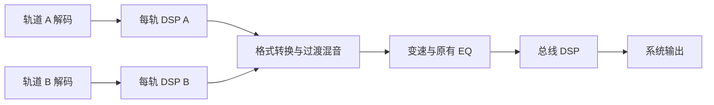

# DSP 双位置配置与验证

日期：2026-10-03。分支：`feature/1.4.0_dev`。

## 实际接线

DSP 插件通过 `PluginDescriptor.dspPlacements` 声明支持的位置及默认位置；`PluginPreference.dspPlacement` 保存用户选择。同一个插件一次只进入选中的位置。

- 每轨混音前：`PluginPCMHostController` → `PluginDSPFactorySpec` → `PluginFFmpegPCMAdapter`。每个解码槽、正式播放与试听均创建独立处理器；处理位于格式转换和过渡混音之前。
- 总线混音后：`PluginAudioHostController` → Apple Audio 效果 → `FFmpegPlaybackEngine.setPostEqualizerEffect`。位置在应用过渡混音和原有 EQ 之后、主 mixer 之前；正式播放与试听各有独立节点。
- 设置 → 插件 → 处理位置：仅列出该插件支持的位置。选择保存到现有 AppSettings/UserDefaults 设置封装。
- 运行中切换：先旁路旧图效果或关闭旧 PCM permission gate，再把新挂载延迟至暂停/停止；停止后通过事件/快照观察重试。已经排队的 PCM 不回写。
- PCM 适配器仅接受 `.perTrack`、零 latency/tail 的处理器，不合规或失败的处理器旁路；因此 App 接线使用 `preservesTiming: true`，保留 gapless/crossfade。

## 兼容性与边界

`reference.gain` 支持两处位置，默认总线混音后；`reference.pcmGain` 仅支持每轨混音前。旧设置没有选择字段时采用插件默认位置；旧插件没有声明时沿用既有宿主分流。未知位置可完整读写，但执行被阻止，用户可在设置中改回支持的位置。

Runtime 校验声明、选择和处理器实际 scope；每次解码槽创建时再次校验 factory 输出。图效果使用对应 Apple Audio factory，无需为授权检查创建多余 PCM 实例。

总线宿主目前有一个效果槽；无对应图实现或槽已占用时，设置快照显示失败及诊断。每轨宿主可安装多个处理器。原有 EQ、歌词/歌曲信息路径保持存在，本次没有将原有 EQ 改写为插件。

## 验证

- Runtime SwiftPM：22 个测试函数通过，包含旧字段缺省、位置持久化、未知值保留、非法声明隔离、factory scope 不匹配拒绝与修正恢复。
- Audio SwiftPM：11 个测试函数通过，覆盖真实离线图效果、权限门、失败旁路和处理预算。
- HostBridge SwiftPM：24 个测试函数通过，包含图/PCM 单路由、暂停后切换、正式播放/试听隔离、无图后端诊断与交错旧请求的 permission gate 恢复（包含并行审查会话补充的回归）。三个包合计 57 个测试函数通过。
- iOS Simulator：MusicFree Regression / iOS 26.5 / `C3DA6A33-6237-4B7E-ADFE-7E429DC54B69`。7 项 DSP AppTests、3 项 UserDefaults 持久化测试、1 项 UI 测试，共 11 项通过；`TEST SUCCEEDED`，实际执行数量非零。普通播放及 crossfade 的关闭/每轨/总线六种输出场景验证增益比例均为 0.5，排除两处重复增益造成的 0.25。状态化处理器测试验证双轨及试听四个槽的状态隔离；暂停切换走真实 FFmpeg 引擎挂载接口；UI 测试选择位置、重启后确认持久化，并恢复进入测试时的位置。
- `Scripts/check_architecture.sh`：通过插件零业务依赖检查与架构检查。`git diff --check` 通过。
- 真机听音、锁屏/路由切换与 Archive：本次未验证。

缓存复用 `.noindex/PluginSystem/{Runtime,Audio,HostBridge}` 和 `.noindex/DerivedData/MusicPlayer`；宿主 Xcode 操作持有 `.noindex/coordination/1.4-shared.lock`。日志保存在 `.noindex/logs/dsp-placement-*.log`。

最终模拟器日志：`.noindex/logs/dsp-placement-simulator-final.log`。结果包：`.noindex/DerivedData/MusicPlayer/Logs/Test/Test-MusicFree-2026.10.03_15-03-59--0400.xcresult`。

过程中修正了两处测试问题：真实引擎事件流只接受一个消费者，切换测试改为单消费者转发给两个控制器（生产仍使用协调器广播快照）；UI 改为直接定位位置 Picker，并在重启后重新查询元素，避免预先滚到启用开关后丢失目标。
